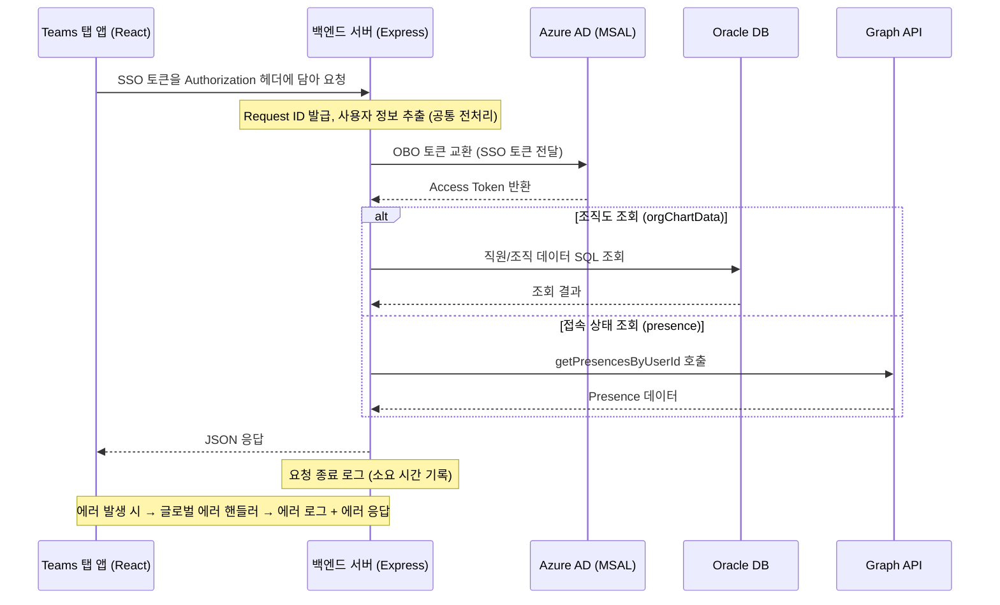

# AsungOrgChartServer — Teams 조직도 앱 백엔드 서버

## 0. Info

- 작성일 : 2026-10-28
- 작성자 : 박여명 주임
- 내용 : Teams 조직도 탭 앱 백엔드(Node.js/Express) 개발 문서. 구조·실행·API·캐시·배치·로그·에러 처리 정리

---

## 1. 먼저 알아둘 것 (주의사항)

| 항목 | 내용 |
|---|---|
| git에 안 올라가는 폴더 | `queries/`, `data/`, `docs/`, `logs/`, `dist/`, `.env`, `node_modules/` 는 `.gitignore`에 등록돼 있다. **운영 서버에 배포할 때 `queries/`와 `.env`는 별도로 복사해야 한다.** `queries/`가 없으면 빌드가 안 된다. |
| 테이블명은 이 문서에 쓰지 않는다 | `queries/`를 git에서 뺀 이유가 "테이블명 노출 방지"다. 테이블·컬럼명은 `queries/*.ts` 파일을 직접 본다. |
| 운영 문서는 별도 파일 | 서버 환경(IIS 프록시, 도메인)은 `docs/operations-guide.md`, PM2 운영은 `docs/pm2-operations-guide.md`를 본다. 이 문서는 개발 관점만 다룬다. |
| 인증 우회 조건 | `USE_MOCK_DB=true` **또는** `NODE_ENV=development` 이면 SSO 검증(OBO)을 건너뛰고 토큰을 디코딩만 한다. 운영 서버에 `NODE_ENV=development`가 설정되면 안 된다. |
| 인증 없는 API | `/api/healthcheck`, `/api/batch/sync`, `/api/users/photo/:email` 은 인증 미들웨어를 타지 않는다. |
| CORS | 모든 출처 허용(`cors()`)이다. 코드 주석에 "프로덕션 환경에서는 특정 도메인만 허용하도록 수정 필요"로 남아 있다. 현재 운영은 IIS 리버스 프록시로 같은 도메인에서 호출하므로 CORS가 실제로 걸리진 않는다. |
| 프로필 사진 갱신 | 매일 01:30에 전 직원 사진을 Graph에서 다시 받는다. 2026-10-28 이전 코드는 파일이 없는 사람만 받아서 바뀐 사진이 반영되지 않았다. (→ 7.2) |
| 시간대 | `process.env.TZ = 'Asia/Seoul'`로 프로세스 전체가 KST다. cron 시각·로그 시각·로그 파일 회전 모두 KST 기준이다. |

---

## 2. 프로젝트 개요

Microsoft Teams 탭 앱(조직도)에서 쓰는 백엔드 서버다.

| 역할 | 내용 |
|---|---|
| 조직도 데이터 제공 | 사내 인사 시스템(Oracle DB)의 조직·직원 데이터를 Teams 탭에 JSON으로 준다. |
| 접속 상태(Presence) | Microsoft Graph API로 직원의 실시간 접속 상태를 조회한다. |
| 프로필 사진 | Graph에서 받은 사진을 서버에 캐시해 두고 ``로 바로 쓸 수 있게 준다. |
| 즐겨찾기 | 사번 기준으로 즐겨찾기 등록·조회·해제를 한다. |
| 일일 배치 | 원본 → `_CHART` 테이블 동기화(01:00), UUID·사진 갱신(01:30). |

백엔드가 필요한 이유

- 브라우저(SPA)는 Oracle DB에 직접 붙을 수 없다. 서버가 중계한다.
- Presence 조회용 Graph 권한은 서버 쪽 OBO(On-Behalf-Of) 토큰 교환이 필요하다.

Node.js를 고른 이유

- MSAL이 Node.js를 공식 지원하고, Teams SSO + OBO 공식 샘플이 Node.js로 제공된다.
- 프론트(React/TypeScript)와 언어가 같아 타입 정의를 공유할 수 있다.

### 2.1 기술 스택

| 구분 | 내용 | 버전 (package.json) |
|---|---|---|
| 런타임 | Node.js | v22.x |
| 언어 | TypeScript | ^5.7.3 |
| 프레임워크 | Express | ^4.21.2 |
| DB | Oracle (node-oracledb Thin Mode) | ^6.10.0 |
| 인증 | @azure/msal-node | ^2.16.2 |
| HTTP 클라이언트 | axios | ^1.7.9 |
| 스케줄러 | node-cron | ^4.2.1 |
| 로그 | winston + winston-daily-rotate-file | ^3.19.0 / ^5.0.0 |

### 2.2 용어

| 용어 | 뜻 |
|---|---|
| SSO 토큰 | Teams 탭 앱이 Azure AD에서 받아 `Authorization: Bearer`로 보내는 토큰 |
| OBO | On-Behalf-Of. 서버가 SSO 토큰을 Azure AD에 주고, Graph API를 호출할 수 있는 Access Token으로 바꾸는 흐름 |
| UUID | Azure AD 사용자 객체 ID. Graph API는 이메일이 아니라 이 값으로 사람을 찾는다 |
| Presence | Teams 접속 상태(availability)와 활동 상태(activity) |
| `_CHART` 테이블 | 원본 HR 테이블을 매일 복사해 둔 조회 전용 테이블. 원본이 깨져도 마지막 정상 데이터가 남는다 |
| Mock 모드 | `USE_MOCK_DB=true`. DB·Azure AD 없이 로컬 더미 데이터로 띄우는 모드 |

---

## 3. 폴더 구조

| 경로 | 역할 | git 포함 |
|---|---|---|
| `server.ts` | 진입점. 미들웨어, 라우트, 서버 시작 | O |
| `utils/auth.ts` | SSO 인증 미들웨어 (`createAuthMiddleware`) | O |
| `utils/db.ts` | Oracle 커넥션 풀, `execute`, `executeTransaction`, `pingDB` | O |
| `utils/logger.ts` | winston 로거 4채널 (requests / app / error / batch) | O |
| `utils/userIdCache.ts` | 이메일 → UUID 인메모리 캐시, 서버 시작 프리로드 | O |
| `utils/photoCache.ts` | 프로필 사진 캐시 (메모리 + `photos/` 파일) | O |
| `batch/syncChartData.ts` | 일일 배치 스케줄러 (01:00 HR 동기화, 01:30 사진 갱신) | O |
| `routes/favorites.ts` | 즐겨찾기 라우터 | O |
| `repositories/favoritesRepository.ts` | 즐겨찾기 저장소 (Oracle / Mock JSON 분기) | O |
| `types/orgChart.ts` | `EmpData`, `OrgData` 타입 | O |
| `queries/*.ts` | SQL 문자열 상수 (orgChart, batchSync, userIdCache, favorites) | **X** |
| `data/` | Mock 모드용 더미 데이터(`empDummyData.ts`, `orgDummyData.ts`), `mockFavorites.json` | **X** |
| `docs/` | 운영 문서, 개발 문서(구) | **X** |
| `photos/` | 사진 캐시 파일 `{uuid}.jpg`. 서버가 자동 생성한다 | X (.gitignore에는 없지만 서버 생성 폴더) |
| `logs/` | 일별 로그 | **X** |
| `dist/` | `tsc` 빌드 결과. 운영은 `dist/server.js`를 실행한다 | **X** |
| `.env` | 환경 변수 | **X** |

`.gitignore`: `data/* queries/* .env node_modules/* logs/* dist/* docs/*`

---

## 4. 실행 방법

### 4.1 환경 변수 (.env)

| 변수 | 용도 | 비고 |
|---|---|---|
| `PORT` | 서버 포트 | 없으면 3000 |
| `CLIENT_ID` | Azure AD 앱 클라이언트 ID | |
| `CLIENT_SECRET` | Azure AD 앱 시크릿 | |
| `TENANT_ID` | Azure AD 테넌트 ID | authority = `https://login.microsoftonline.com/{TENANT_ID}` |
| `DB_USER` / `DB_PASSWORD` / `DB_CONNECT_STRING` | Oracle 접속 | 예: `host:1521/서비스명` |
| `DB_CONNECT_TIMEOUT` | DB 연결 시도 제한(초) | 없으면 60 |
| `USE_MOCK_DB` | `true`면 Mock 모드 | DB·AAD 생략, 더미 데이터 |
| `NODE_ENV` | `development`면 인증 우회 | **운영에서 설정 금지** (→ 1장) |
| `MOCK_FAVORITES_PATH` | Mock 즐겨찾기 JSON 경로 | 없으면 `data/mockFavorites.json` |

Azure AD 앱에 필요한 권한

- 서버 시작 프리로드·사진 다운로드는 Client Credentials(앱 전용 토큰)로 Graph를 호출한다. 코드 주석에 "User.Read.All 애플리케이션 권한 + 관리자 동의 필요"로 적혀 있다.
- OBO 요청 scope는 `User.Read` 다.

### 4.2 npm 스크립트

| 명령 | 동작 |
|---|---|
| `npm run dev` | `ts-node server.ts` (빌드 없이 실행) |
| `npm run build` | `tsc` → `dist/` |
| `npm start` | `node dist/server.js` |

### 4.3 로컬(Mock 모드) 실행

`.env`에 `USE_MOCK_DB=true` 를 넣고 `npm run dev` 한다.

Mock 모드에서 바뀌는 동작

| 항목 | 운영 모드 | Mock 모드 |
|---|---|---|
| DB 연결 | `initDB()` 실패 시 서버 종료 | 연결 안 함 |
| 배치 스케줄러 | 등록 | 등록 안 함 |
| UUID·사진 프리로드 | 실행 | 실행 안 함 (사진은 전부 "없음" 응답) |
| 인증 | OBO 검증 | 토큰 디코딩만. 디코딩 실패 시 토큰 자리에 이메일 평문을 넣어도 통과 |
| `/api/orgChartData` | DB 조회 | `data/empDummyData.ts`, `data/orgDummyData.ts` 를 런타임 `require` (파일 없으면 빈 배열 + 경고) |
| `/api/users/presence` | Graph 조회 | 전원 `Available` 반환 |
| `/api/favorites` | Oracle | `data/mockFavorites.json` 파일 읽기/쓰기 |

주의: `data/empDummyData.ts`는 현재 `types/orgChart.ts`의 `EmpData`(필수 필드 `empId`)와 맞지 않아 `tsc`에서 타입 오류가 1,686건 난다. `tsc`는 기본 설정에서 오류가 있어도 `dist/`를 내보내므로 실행은 되지만 `npm run build`가 실패 코드로 끝난다. 운영 서버에는 `data/`가 없으므로 영향 없다.

---

## 5. 요청 처리 흐름

### 5.1 전체 흐름



### 5.2 공통 전처리 미들웨어

| 처리 | 내용 |
|---|---|
| Request ID 발급 | `Date.now().toString(36) + '-' + 랜덤5자` (예: `kz3x91a-5k9a1`). 앞부분이 시간 기반이라 정렬된다. `req.requestId`에 붙인다 |
| 사용자 추출 | Authorization 헤더의 JWT를 디코딩해 `upn` → `name` → `sub` 순으로 꺼낸다. 헤더 없으면 `Guest`, 디코딩 실패면 `InvalidToken`. `req.userPrincipal`에 붙인다 |
| 요청 로그 | 응답이 끝나면(`res.on('finish')`) requests 채널에 한 줄 남긴다. **`/api/users/photo/` 요청은 로그에서 뺀다** (건수가 많아서) |

### 5.3 인증 미들웨어

| 단계 | 내용 | 실패 시 |
|---|---|---|
| ① 헤더 검사 | `Authorization: Bearer <SSO토큰>` 형식인지 본다 | 403 |
| ② 로컬 우회 | `USE_MOCK_DB=true` 또는 `NODE_ENV=development` 면 OBO 없이 JWT 디코딩만으로 `req.userEmail`을 채우고 통과. `req.accessToken = 'mock-access-token'` | 디코딩 실패 + 이메일 평문도 아니면 401 |
| ③ OBO 교환 | `cca.acquireTokenOnBehalfOf({ oboAssertion, scopes: ['User.Read'] })` | 토큰 못 받으면 401 |
| ④ 이메일 추출 | JWT의 `upn` → `unique_name` → `email` 순. 소문자로 `req.userEmail`에 저장. `req.accessToken`에 OBO 결과 저장 | 없으면 401 |
| 예외 | MSAL `invalid_grant` → 401 "SSO 토큰이 만료되었습니다" | 그 외는 글로벌 핸들러로 |

---

## 6. API 목록

| 엔드포인트 | 메서드 | 인증 | 설명 |
|---|---|---|---|
| `/api/healthcheck` | GET | 없음 | 서버·DB 상태. DB가 죽어도 200 (`db: connected/disconnected/error`) |
| `/api/batch/sync` | GET | **없음** | HR 동기화 배치 즉시 실행 (수동) |
| `/api/orgChartData` | GET | SSO | 조직·직원 전체 데이터 `{ orgList, empList }` |
| `/api/users/presence` | POST | SSO | 접속 상태 일괄 조회. Body `{ ids: [이메일 또는 UUID, ...] }` |
| `/api/users/photo/:email` | GET | **없음** | 프로필 사진 JPEG. 없으면 투명 1×1 JPEG |
| `/api/favorites` | GET | SSO | 내 즐겨찾기 목록 |
| `/api/favorites` | POST | SSO | 즐겨찾기 등록. Body `{ targetEmpId }` → 201 |
| `/api/favorites/:targetEmpId` | DELETE | SSO | 즐겨찾기 해제 |

### 6.1 조직도 조회 `/api/orgChartData`

- 직원 쿼리 → 조직 쿼리를 **순차** 실행한다. `Promise.all`로 병렬 실행하면 커넥션을 동시에 2개 잡아 풀(최대 10)이 빨리 마른다.
- SQL은 `queries/orgChart.ts`. 결과 컬럼명은 `EmpData`/`OrgData` 필드명과 같게 alias를 준다.
- 응답 `{ orgList: OrgData[], empList: EmpData[] }`.

### 6.2 접속 상태 조회 `/api/users/presence`

| 단계 | 내용 |
|---|---|
| ① 입력 검사 | `ids`가 빈 배열이거나 배열이 아니면 400 |
| ② 이메일 → UUID | `@`가 있으면 이메일, 없으면 UUID로 본다. 이메일은 `resolveEmailsToUuids`로 변환 (→ 7.1) |
| ③ Presence 조회 | `POST graph.microsoft.com/v1.0/communications/getPresencesByUserId`, 15명씩 나눠 호출. 한 묶음이 실패해도 나머지는 계속 (실패 묶음은 error 로그) |
| ④ 응답 | `[{ email, availability, activity }]`. UUID로 직접 들어온 건 `email` 자리에 UUID가 들어간다 |
| 예외 | `invalid_grant` → 401 |

Graph 호출은 전역 HTTPS Agent(`keepAlive`, `maxSockets 100`, `timeout 5초`)를 쓴다. 100은 Graph Presence 제한(1,500 req/30s = 50 TPS) × 평균 응답 0.2초 ≈ 10개에 여유를 둔 값이다.

### 6.3 프로필 사진 `/api/users/photo/:email`

- 프론트는 `` 으로 쓴다. 인증 헤더를 못 붙이는 `` 특성 때문에 인증이 없다. (코드 주석에도 "인증 헤더를 포함하도록 해야할거 같은데"로 남아 있다.)
- 이메일에 `@`가 없으면 400.
- 캐시(→ 7.2)에서 Buffer를 꺼내 `Content-Type: image/jpeg`, `Cache-Control: public, max-age=43200`(12시간)으로 준다.
- 사진이 없으면 204가 아니라 **투명 1×1 JPEG를 200으로** 준다. 204는 body가 없어 브라우저가 캐시하지 않기 때문이다.
- **브라우저가 12시간 캐시하므로 서버 사진이 바뀌어도 사용자에게는 최대 12시간 뒤에 보인다.**

### 6.4 즐겨찾기 `/api/favorites`

- 식별 키는 이메일이 아니라 **사번(empId)** 이다. 이메일이 바뀌어도 데이터가 유지된다.
- 본인 사번은 헤더 `x-user-empid` → 쿼리 `userEmpId` → 바디 `userEmpId` 순으로 읽는다. 없으면 400 "HR 시스템에 사원 정보가 등록되어 있지 않습니다".
- 프론트가 전체 사원 목록에서 로그인 이메일로 본인 사번을 찾아 보내는 구조다.

| 동작 | 응답 | 오류 |
|---|---|---|
| GET | `[{ targetEmpId, createdAt }]` (최신순) | |
| POST `{ targetEmpId }` | 201 `{ success, message, data: { targetEmpId, createdAt } }` | 중복이면 409 (Oracle `ORA-00001`을 409로 바꿈) |
| DELETE `/:targetEmpId` | `{ success, message }` | 없는 건이면 404 |

테이블·컬럼명은 `queries/favorites.ts`를 본다. 본인 사번 + 대상 사번에 복합 유니크 제약이 있어 중복 등록이 DB에서 막힌다.

---

## 7. 캐시

### 7.1 이메일 → UUID 캐시 (`utils/userIdCache.ts`)

Graph API는 UUID로만 사람을 찾는다. 매번 Graph에 이메일을 물어보지 않으려고 인메모리 `Map<email, uuid>`를 둔다. 매핑은 DB 테이블(`queries/userIdCache.ts`)에도 저장해 재시작 때 다시 쓴다.

| 시점 | 함수 | 동작 |
|---|---|---|
| 서버 시작 | `preloadUserUuids` | ① DB 매핑 전체 로드 → ② `_CHART` 직원 테이블의 이메일 전체 조회 → ③ DB에 없는 이메일만 Graph `$filter`로 15건씩 조회 → ④ 캐시 + DB(MERGE) 저장. 앱 전용 토큰(Client Credentials) 사용 |
| 매일 01:30 | `preloadUserUuids` (재실행) | 위와 같다. 01:00 HR 배치로 들어온 신규 입사자만 추가 조회된다. (2026-10-28 추가) |
| 요청 시 | `resolveEmailsToUuids` | 캐시 미스만 Graph 조회(15건씩, 사용자 OBO 토큰) 후 캐시 + DB 저장. 요청마다 hit/miss 통계를 app 로그에 남긴다 |

- Graph 조회 429(rate limit) 시 `Retry-After` 초만큼 기다렸다가 같은 묶음을 다시 시도한다.
- 프리로드 실패는 치명적이지 않다. 경고 로그만 남기고 서버는 뜬다 (요청 시 개별 조회로 보완).

### 7.2 프로필 사진 캐시 (`utils/photoCache.ts`)

| 계층 | 저장소 | 용도 |
|---|---|---|
| L1 | `Map<uuid, Buffer>` (메모리) | 런타임 서빙 |
| L2 | `photos/{uuid}.jpg` (파일) | 서버 재시작 때 Graph를 다시 안 부르고 복구 |

사진 출처: `GET graph.microsoft.com/v1.0/users/{uuid}/photos/96x96/$value` (앱 전용 토큰, 1건씩, 타임아웃 5초)

| 시점 | 함수 | 동작 |
|---|---|---|
| 서버 시작 | `preloadPhotos` | ① `photos/*.jpg` 전부 메모리에 올림 → ② UUID 캐시 전체 중 **파일이 없는 uuid만** Graph에서 다운로드 → 메모리 + 파일 저장 |
| 매일 01:30 | `refreshAllPhotos` | UUID 캐시 전체를 **파일 유무와 상관없이** Graph에서 다시 받는다. 메모리를 미리 비우지 않는다 |

갱신 시 응답별 처리

| Graph 응답 | 처리 |
|---|---|
| 200 | 메모리·파일 덮어쓰기 (갱신 건수) |
| 404 | 사진을 지운 사람. 메모리·파일에서 제거 (삭제 건수) |
| 429 | `Retry-After` 초 대기 후 큐 맨 뒤에 다시 넣음 |
| 그 외 오류 | 기존 사진 유지 (실패 건수) |

갱신이 잘 도는지 확인하는 로그 (app 채널)

- 정상: `[Photo Refresh] 전체 사진 갱신 완료: 갱신 N건, 삭제 N건, 실패 N건.` — 갱신 N이 직원 수에 가까워야 한다.
- 2026-10-28 이전 코드는 `refreshAllPhotos`가 `preloadPhotos`를 그대로 불러서 매일 `신규 사진 필요: 0건`으로 끝났다. 이것이 "사진을 바꿔도 안 바뀐다" 문의의 원인이었다.

운영 서버에서 전원 사진을 강제로 다시 받고 싶을 때: `photos/` 폴더를 비우고 재시작한다. (프리로드가 전부 "파일 없음"으로 보고 받는다.)

---

## 8. 일일 배치 (`batch/syncChartData.ts`)

| 시각 (KST) | 작업 | 함수 |
|---|---|---|
| 01:00 | 원본 HR 테이블 → `_CHART` 테이블 복사 | `syncChartTables` |
| 01:30 | UUID 캐시 재갱신 → 전 직원 사진 재다운로드 | `preloadUserUuids` → `refreshAllPhotos` |

HR 동기화 동작

1. 원본 직원·조직 테이블 건수를 센다. **어느 하나라도 0건이면 배치를 건너뛴다** (빈 데이터로 덮어쓰기 방지).
2. 하나의 트랜잭션으로 `DELETE → INSERT`(조직) → `DELETE → INSERT`(직원)를 실행한다. 중간에 실패하면 전체 롤백돼 기존 `_CHART` 데이터가 남는다.
3. 로그는 batch 채널(`logs/batch/`)에 남고, 실패는 error 채널에도 같이 남는다.

수동 실행: `GET /api/batch/sync` (인증 없음). 사진 갱신만 수동으로 돌리는 API는 없다.

Mock 모드에서는 스케줄러를 등록하지 않는다.

---

## 9. DB 연결 (`utils/db.ts`)

| 설정 | 값 |
|---|---|
| 모드 | Thin Mode (Oracle Instant Client 불필요) |
| 풀 | `poolMin 2`, `poolMax 10`, `poolIncrement 1` |
| `connectTimeout` | `DB_CONNECT_TIMEOUT` 또는 60초 |
| `poolPingInterval` | 60초. 60초 이상 논 커넥션은 꺼낼 때 ping 후 죽었으면 버린다 |
| `enableStatistics` | true. 로그에 `Open=N, Busy=N` 풀 상태를 찍는다 |

동작

- `initDB`: 풀 생성 후 실제로 커넥션 하나를 꺼내 봐서 연결을 확인한다 (Thin 모드는 `createPool`만으로는 연결하지 않는다). 실패하면 서버가 뜨지 않고 종료한다.
- `execute(sql, binds, options, requestId)`: 커넥션 꺼내서 실행 후 반납. 기본 `outFormat: OBJECT`, `autoCommit: true`.
- `executeTransaction(queries[], requestId)`: 커넥션 하나로 순차 실행 후 한 번에 commit. 실패하면 rollback.
- 자동 재연결: 아래 코드의 오류가 나면 풀을 다시 만들고 **1회 재시도**한다. 동시에 여러 요청이 재연결을 요구해도 풀은 한 번만 다시 만든다 (Promise 공유).
  - `NJS-500, NJS-521, NJS-040, NJS-018, ORA-03114, ORA-03135, ORA-12541, ORA-12543, ORA-12170, ORA-12571, DPI-1080`
- 쿼리 문법·제약 오류는 재시도하지 않고 그대로 던진다.
- `pingDB`: healthcheck 전용. 실패해도 throw하지 않고 false.

---

## 10. 로그 (`utils/logger.ts`)

| 채널 | 경로 | 용도 | 콘솔 출력 |
|---|---|---|---|
| requests | `logs/requests/YYYY-MM-DD.log` | HTTP 요청 한 줄 요약 (통계용). 시간·레벨 없이 메시지만 | X |
| app | `logs/app/YYYY-MM-DD.log` | 내부 흐름 (DB 커넥션, 캐시, 프리로드, 배치 외 전부) | O |
| error | `logs/error/YYYY-MM-DD.log` | 에러 전용. 글로벌 핸들러 Stack Trace | O |
| batch | `logs/batch/YYYY-MM-DD.log` | 01:00 HR 동기화 배치 전용 | O |

- 사진 갱신(01:30) 로그는 batch가 아니라 **app** 채널에 남는다. (`[Photo Refresh]`, `[Photo Preload]`, `[UUID Preload]`)
- 보관: 일별 파일, **180일** 지나면 삭제, 지난 파일은 `.gz` 압축.
- 시간은 KST `YYYY-MM-DD HH:mm:ss`.

requests 채널 한 줄 형식
```
[시작시간 - 종료시간][RequestID][User:사용자] METHOD /url - 상태코드 (소요ms)
예) [2026-02-12 14:30:01 - 2026-02-12 14:30:01][kz3x91a-5k9a1][User:hong@company.com] GET /api/orgChartData - 200 (142ms)
```

추적 방법: 에러 응답의 `requestId`로 error 로그를 찾고, 같은 ID로 app 로그를 따라가면 DB 커넥션·Graph 호출 흐름이 나온다.

---

## 11. 에러 처리

각 라우트는 에러를 직접 응답하지 않고 `next(error)`로 글로벌 핸들러에 넘긴다.

등록 순서: ① 라우터 → ② 404 핸들러(인자 3개) → ③ 글로벌 에러 핸들러(인자 4개). Express는 `next(error)`가 오면 일반 핸들러를 건너뛰고 인자 4개짜리로 간다.

글로벌 핸들러

| 단계 | 내용 |
|---|---|
| 상태 코드 | `err.status`가 있으면 그 값, 없으면 500 |
| error 로그 | RequestID, 메서드·URL, 사용자, 메시지, Stack Trace |
| 응답 | `{ success: false, status, requestId, message }`. 500이면 message는 "서버 내부 오류가 발생했습니다."로 고정, 그 외는 실제 메시지 |

---

## 12. 배포 (요약)

상세는 `docs/pm2-operations-guide.md` 6장을 본다.

```cmd
cd C:\AsungOrgChart\Server
git pull
npm run build
pm2 restart orgchart-server
pm2 status
```

- 서버 경로·프로세스명은 운영문서 기준이다. 다르면 `pm2 status`로 확인한다.
- `queries/`, `.env`는 git에 없다. 운영 서버에 이미 있는 것을 쓰고, SQL이 바뀌었으면 따로 복사한다.
- 배포 후 확인: `pm2 logs --lines 100`에서 `Oracle DB 커넥션 풀 생성 및 연결 테스트 성공`, `[UUID Preload] 완료`, `[Photo Preload] 완료`가 순서대로 찍히면 정상이다.

---

## 변경 이력

| 날짜 | 내용 |
|---|---|
| 2026-10-28 | 최초 작성. docs/backend-development-guide.md 내용을 통합하고 폴더 구조·실행 방법·캐시·배치·DB·주의사항 추가. 프로필 사진 갱신 로직 수정(전원 재다운로드) 반영 |
